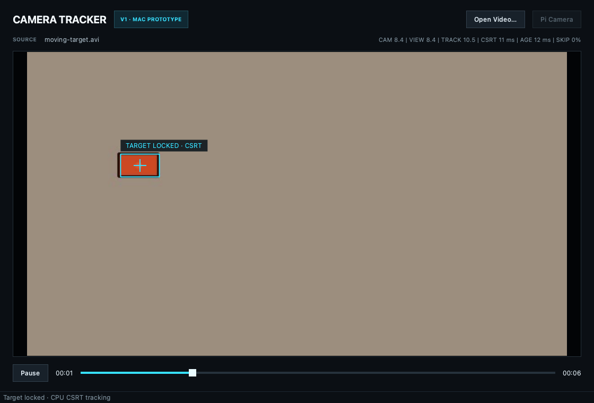

# CSRT Camera Tracker

CPU-only object tracking with Qt 6, GStreamer and OpenCV. Click once to select a target; asynchronous CSRT updates use a latest-frame mailbox so busy tracking cannot build a queue of stale frames. Recorded video supports playback, seeking and reselection. The Raspberry Pi IMX477 source shares the same canvas and controller.



## Build and test

Requires a C++20 compiler, CMake 3.24+, Qt 6.5+ (Core, Gui, Widgets, Test), OpenCV 4 with the tracking module, pkg-config, and GStreamer 1.20+ (core, app and video development libraries). The file tests need `videotestsrc`, JPEG/AVI, x264/H.264/MP4 encoders and decoders. On macOS `scripts/bootstrap-mac.sh` can install missing Homebrew dependencies when deliberately run; it was not used to install software during release preparation.

```bash
cmake -S . -B build -DCMAKE_BUILD_TYPE=Release
cmake --build build --parallel
QT_QPA_PLATFORM=offscreen ctest --test-dir build --output-on-failure
```

On macOS:

```bash
./build/CameraTracker.app/Contents/MacOS/CameraTracker --open samples/moving-target.avi
```

On Linux use `./build/CameraTracker --open samples/moving-target.avi`. Click the red target near the left of the frame. Seeking resets selection. The bundled six-second sample is synthetic; `scripts/generate-sample.py` regenerates it using Python, NumPy and OpenCV. No external footage is distributed.

To reproduce the test screenshot:

```bash
QT_QPA_PLATFORM=offscreen CSRT_DEMO_SCREENSHOT="$PWD/samples/tracking-demo.png"   ./build/main_window_tests recordedDemoTracksMovingTarget
```

## Raspberry Pi

The checked-in camera profile requests 2028×1080, 50 FPS, 12-bit IMX477 frames. Configuration is in `config/camera-tracker.ini`; restart after editing camera or tracker parameters. Pi camera use needs Raspberry Pi OS, libcamera/GStreamer camera plugins and the physical sensor. It is disabled on macOS.

On the target Pi, `scripts/setup-rpi.sh`, `scripts/build-rpi.sh`, `scripts/diagnose-rpi.sh`, and `scripts/run-rpi.sh` provide the original setup/build/diagnostic workflow. Setup may install OS packages; diagnostics open the camera. SSH sync scripts require an explicit `RPI_TARGET=user@host` and accept `RPI_REMOTE_ROOT` (default `CameraTracker`, relative to the remote home). No deployment host is embedded in this copy.

See [VERIFICATION.md](VERIFICATION.md) for fresh desktop results and [historical hardware evidence](docs/HISTORICAL_EVIDENCE.md) for the inherited Pi baseline. Optuna tuning scripts and benchmark datasets were not recovered in this source copy; no new tuning result is claimed.

## Attribution and rights

Prepared from Emre Karausta's internship project working copy. Existing source and dependency attribution is retained. Qt, GStreamer and OpenCV remain under their respective licenses; they are dependencies, not vendored code. No blanket project license has been inferred. This package is a local release candidate; no repository was created or published.
