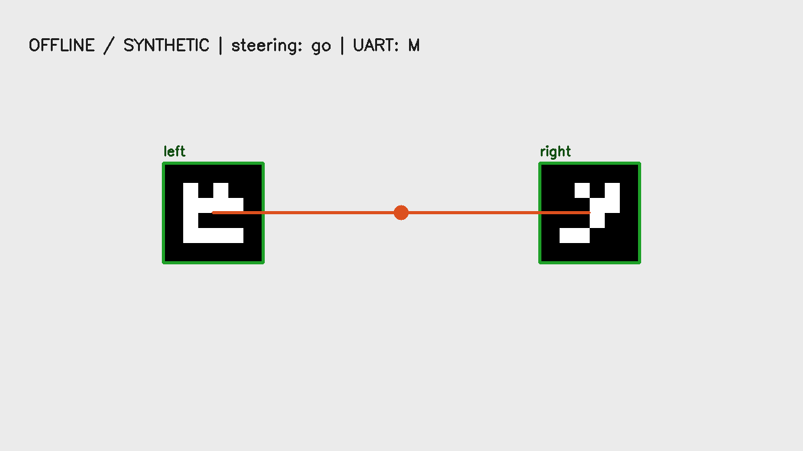

# RoverD: custom-marker gate navigation

Shared Group D two-wheel rover project: Raspberry Pi vision identifies paired 4×4 markers, smooths gate position and emits steering letters; Raspberry Pi Pico C++ firmware maps those letters into slew-limited differential motor PWM with a UART watchdog.



## Safe offline demonstration

Python 3.10+, NumPy and OpenCV are sufficient. The demo imports no GPIO, serial or camera modules and opens no hardware.

```bash
python3 -m venv .venv
. .venv/bin/activate
python -m pip install -r final_navigation/vision/requirements.txt
python final_navigation/vision/offline_demo.py --output demo-output
PYTHON=python ./tests/run-offline.sh
```

The demo generates both marker cards, runs the actual contour/pattern/gate/steering pipeline, and writes `gate-demo.png` and `result.json`. The bundled generated output reports two markers, a center near x=640, command `go`, and letter `M` (the contour center is just left of the M/N boundary). It contains no camera footage.

The test script runs six Python tests and four native C++ firmware scenarios. Its tiny fake Pico SDK supplies only UART, clock and output boundaries; parser, timeout and steering logic come directly from the production firmware header. It validates software behavior without energizing motors.

## Build Pico firmware

Install an official Raspberry Pi Pico SDK and ARM embedded compiler separately, then use their locations:

```bash
cmake -S final_navigation/firmware -B build-pico   -DPICO_SDK_PATH=/path/to/pico-sdk   -DPICO_TOOLCHAIN_PATH=/path/to/arm-toolchain
cmake --build build-pico --parallel
```

This generates `build-pico/rover_move.uf2` for the default RP2040 Pico board. No firmware was flashed during verification. The copy fixes rejection of entire overlong UART lines, the time-zero receive/timeout edge case, equal wheel output in the configured straight band, and SDK path selection with `-D`.

## Physical runtime

`final_navigation/vision/main.py` is the Pi camera/GPIO/UART runtime. Running it can move the rover. It additionally requires Raspberry Pi OS packages providing `picamera2`, `RPi.GPIO` and `serial` (`pyserial`), and working libcamera support. Use distro packages for Pi camera/GPIO integration; the offline requirements deliberately cover only desktop execution. Review pins, UART selection, power, motor polarity and mechanical calibration before using hardware. `test_visualise_laptop.py` is an optional live-camera tool, separate from the offline demo.

The firmware receives one ASCII `A-Z`, `a-z` or `?` followed by LF or CR. The letter selects steering; case currently has no effect on PWM. `?` requests a slew-limited stop; the 300 ms link timeout invokes an immediate zero output after expiry. Invalid packets do not refresh that timeout.

## Scope and evidence

See [VERIFICATION.md](VERIFICATION.md). This is the recovered camera/custom-marker + C++ Pico stack. The master CV's deployed MicroPython forward-ToF reactive fallback was not found in this source and is not implemented or verified here. Physical gate traversal, calibrated 90-degree turns, power electronics and race outcomes have not been rerun by this package.

## Attribution and rights

This is shared five-person Group D project work, not a claim of sole authorship of every module. Original code comments are retained; the recovered files did not contain a complete contributor ledger or project license. Existing contributors retain their rights. OpenCV, NumPy, Pico SDK and the Pi runtime libraries retain their own licenses and are not vendored. No blanket license is assigned here. Legacy zipped builds and deployment-specific personal paths are excluded.
