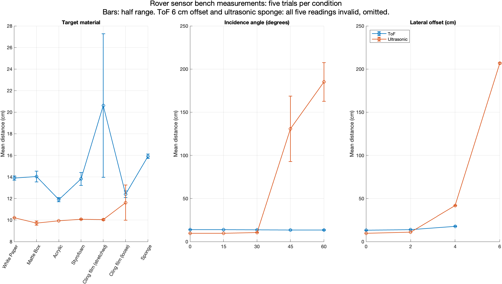

# Rover obstacle-sensor evaluation

Bench measurements by Emre Karausta comparing HC-SR04 ultrasonic and VL53L0X time-of-flight sensors, using a teammate-prepared Raspberry Pi Pico/MicroPython acquisition setup during University of Southampton rover coursework.

The public data is a focused extraction of 160 readings from the original measurement workbook: five trials for seven materials, five incidence angles (0–60°), and four lateral offsets (0–6 cm), for each sensor. `data/trials.csv` retains source-cell coordinates. `data/summary.csv` recomputes means and half ranges from the trials. The private report, workbook and photographs are not redistributed.

## Reproduce

```sh
python3 -m unittest discover -s tests
python3 analyze.py
```

Analysis uses Python's standard library. To regenerate the chart in MATLAB, run `plot_results`. This optional plot requires MATLAB only.



Invalid readings are the documented sentinels: 819 cm for ToF and −0.02 cm for ultrasonic. They count as failed readings and are excluded from means. Half range is `(maximum−minimum)/2` in centimetres, not a confidence interval or percentage uncertainty. At least one valid reading is required for a mean. The original report describes nominal 10 cm placement; the ToF setup was uncalibrated, so this dataset does not establish comparative absolute accuracy.

The ultrasonic sensor gave unreliable target readings at 45–60° and five invalid readings for sponge. ToF gave five invalid readings at 6 cm lateral offset. A transparent-acrylic angle failure was a separate qualitative observation in the report, not a recorded condition in this workbook. The suggested arrangement—forward ToF and ultrasonics angled ±25°, invalid-reading rejection and fallback logic—was a design proposal, not a validated fused sensing system.

See [VERIFICATION.md](VERIFICATION.md) for evidence and limitations, and [ATTRIBUTION.md](ATTRIBUTION.md) for publication rights.
